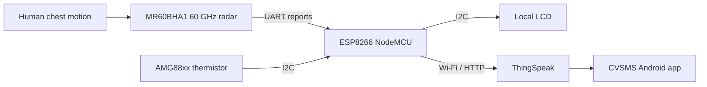

# Contactless Human Vital Sign Monitoring Using 60 GHz FMCW Radar

**CVSMS — My undergraduate capstone project at American International University–Bangladesh (AIUB)**

**Simanta Saha** · Capstone Team Lead · Electrical & Electronic Engineering  
*Radar sensing · Signal processing · Embedded systems · Internet of Medical Things*

[](https://doi.org/10.1109/BECITHCON64160.2024.10962775)  


*Our assembled CVSMS prototype alongside the Android monitoring interface.*

## About the project

During my final-year undergraduate studies at AIUB, I led a four-member team in developing **CVSMS**, a contactless vital-sign monitoring system based on a **60 GHz millimeter-wave radar**. We wanted to explore whether breathing and heartbeat could be monitored without attaching electrodes or probes to a person, while keeping the measurements accessible locally and over the internet.

We integrated the **MR60BHA1 radar**, **ESP8266 NodeMCU**, **AMG88xx thermal sensor**, **I²C LCD**, **ThingSpeak**, and an Android application built with **MIT App Inventor**. We also studied the underlying FMCW principles in MATLAB and compared the prototype's readings with reference measurements.

The work brought together the areas I enjoy most: electrical engineering, radar, signal analysis, firmware, connected systems, and experimental evaluation.

## What we built

| Subsystem | Our implementation |
|---|---|
| **Contactless sensing** | MR60BHA1 60 GHz radar provides heart-rate and respiratory-rate reports |
| **Controller** | ESP8266 NodeMCU reads the radar and thermal sensor, updates the LCD, and transmits readings |
| **Temperature channel** | AMG88xx thermistor reading; not a clinically validated core-body temperature measurement |
| **Display** | LCD for immediate readings at the prototype |
| **Cloud** | ThingSpeak channels for heart rate, breathing rate, and thermistor temperature |
| **Android app** | CVSMS monitoring interface developed through MIT App Inventor |
| **MATLAB** | Transmitted and received chirps, IF/beat signal, FFT, and spectrogram simulation |
| **Evaluation** | Comparative heart-rate and respiratory-rate measurements across younger and older volunteers |

### End-to-end architecture



The **MR60BHA1 generates vital-sign reports internally**. Our MATLAB simulation is a separate analysis of FMCW waveforms—not the algorithm running inside the module. This distinction is important when interpreting the code and results.

## Explore my project

I have arranged the work in the same order as our engineering process, from the research problem through circuit design, programming, testing, and publication. Each chapter includes explanations and the original figures where available.

| Chapter | What I cover |
|---|---|
| **01** | [Why we chose this problem and what we set out to achieve](docs/01-problem-and-objectives.md) |
| **02** | [Our research methodology and development stages](docs/02-methodology.md) |
| **03** | [System architecture and the route taken by each measurement](docs/03-system-architecture.md) |
| **04** | [Circuit diagram, pin connections, power and enclosure](docs/04-circuit-and-wiring.md) |
| **05** | [FMCW radar theory: chirps, reflections, range and chest motion](docs/05-fmcw-radar-theory.md) |
| **06** | [MATLAB simulation, equations, source code and results](docs/06-matlab-analysis.md) |
| **07** | [ESP8266/Arduino firmware and data acquisition](docs/07-firmware.md) |
| **08** | [ThingSpeak cloud dashboard and MIT App Inventor application](docs/08-iot-android.md) |
| **09** | [Our experiments, result graphs and error calculations](docs/09-results.md) |
| **10** | [How to run the code and understand the hardware setup](docs/10-reproduction.md) |
| **11** | [Team, supervisors, awards and IEEE publication](docs/11-team-and-publication.md) |
| **12** | [Original files, later examples and source attribution](docs/12-source-provenance.md) |
| **13** | [Engineering choices, cost considerations and project planning](docs/13-design-decisions-and-management.md) |
| **14** | [Limitations, what I learned and where I would take the work next](docs/14-limitations-and-next-steps.md) |

[**Browse the project figure index**](docs/FIGURE_INDEX.md) for the original figure numbers and corresponding files.

## Our experimental results

In our capstone study, we recorded **90 measurements from 18 volunteers**. The heart-rate and respiratory-rate comparison scores reported in our project were:

| Age group | Heart-rate score | Respiratory-rate score |
|---|---:|---:|
| **22–25 years** | **92.11%** | **89.88%** |
| **45–79 years** | **96.05%** | **93.73%** |

These scores are expressed as **100 − mean absolute percentage error (MAPE)**. They describe agreement in the measurements we reported; they are **not clinical diagnostic accuracy, sensitivity, or specificity**. See the [experimental results](docs/09-results.md) for the original comparison graphs and limitations.

<p align="center">
  
  
</p>

## Code and engineering files

| File | What it demonstrates |
|---|---|
| [`matlab/fmcw_original_from_capstone.m`](matlab/fmcw_original_from_capstone.m) | MATLAB FMCW simulation transcribed from Appendix Z of our capstone book |
| [`matlab/fmcw_corrected_demo.m`](matlab/fmcw_corrected_demo.m) | Separate synthetic baseband range-FFT demonstration |
| [`firmware/esp8266/CVSMS_ESP8266/CVSMS_ESP8266.ino`](firmware/esp8266/CVSMS_ESP8266/CVSMS_ESP8266.ino) | Reconstructed ESP8266 program for radar reports, LCD, thermistor and ThingSpeak |
| [`src/demo.py`](src/demo.py) | Separate Python illustration of synthetic breathing and heartbeat signals |
| [`assets/project-images/`](assets/project-images/) | Prototype images, schematics, simulation plots, application and experiment figures |

The firmware is reconstructed from the code printed in our book, with configuration credentials removed and network formatting adjusted. The synthetic MATLAB and Python examples were prepared separately from our experimental data. I have kept them clearly distinguished from the original capstone materials.

## Publication and recognition

Our capstone received the **Dean's Award for Best Capstone Project at AIUB**, and I received the **Vice Chancellor's Award** at AIUB's 23rd Convocation.

Our related paper was presented at **IEEE BECITHCON 2024**:

**Md. Sayzar Rahman Akash, Simanta Saha, Md. Shakil Ahamed Sagor, Nazmus Sakib Nihal, Shilamoni Shaha Neir, and Mohammad Hasan Imam.** “Contactless Human Vital Sign Monitoring System Using Millimeter Wave FMCW Radar for Healthcare Applications.” *IEEE BECITHCON 2024*, pp. 137–142. [Read the paper / DOI](https://doi.org/10.1109/BECITHCON64160.2024.10962775).


## The people behind CVSMS

I led this capstone alongside **Nazmus Sakib Nihal**, **Md. Shakil Ahamed Sagor**, and **Shilamoni Shaha Neir**. Our supervisor was **Dr. Mohammad Hasan Imam**, and our external supervisor was **Dr. Md. Humayun Kabir**. The design, implementation, measurements, and research output represent our work as a team. I maintain this project under my GitHub profile to present what we accomplished together and the engineering experience I gained while leading it.

## Running the project material

```bash
# Independent synthetic Python demonstration (not original radar data)
python -m pip install -r requirements.txt
python -m src.demo
python -m pytest -q
```

For MATLAB, see the [simulation walkthrough](docs/06-matlab-analysis.md). For the ESP8266, see the [firmware chapter](docs/07-firmware.md) and the [hardware setup](docs/10-reproduction.md).

**Technical scope:** CVSMS is an academic prototype, not a certified medical device. The published firmware requires hardware-specific verification before deployment. The MIT App Inventor screenshots are included, but an editable `.aia` export and participant-level raw data are not included. The [source record](docs/12-source-provenance.md) explains these boundaries.
