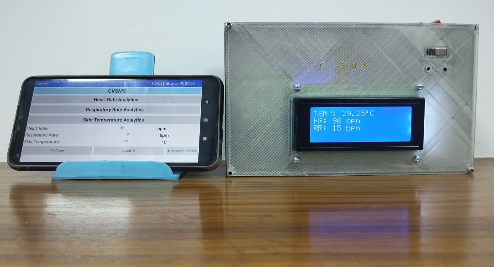
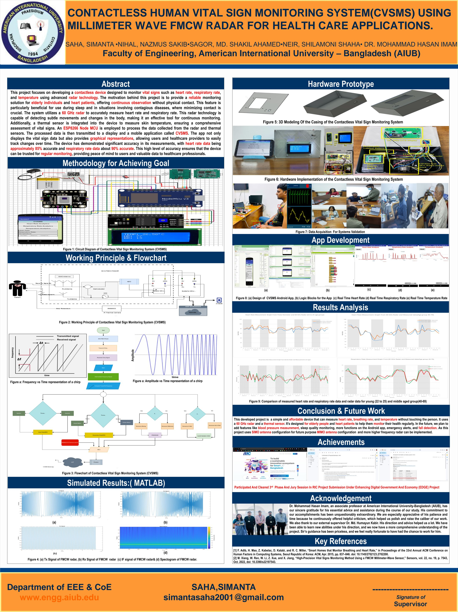
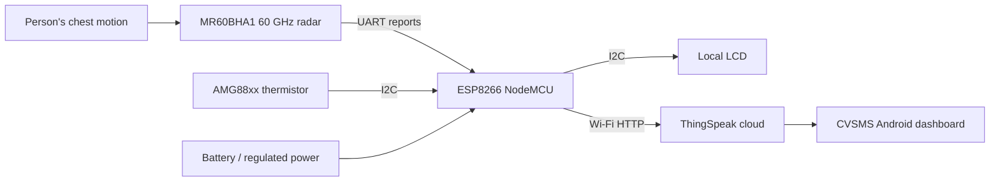

# CVSMS | Contactless Human Vital Sign Monitoring System

**60 GHz FMCW Radar · Embedded Systems · Biomedical Sensing · Internet of Medical Things · MATLAB**

**Simanta Saha — Capstone Team Lead & Repository Maintainer**  
American International University–Bangladesh (AIUB) | Spring 2023–2024

[](https://doi.org/10.1109/BECITHCON64160.2024.10962775)  

> **Start here:** This repository presents our collaborative undergraduate capstone as an engineering project rather than a thesis manuscript. I led the capstone team and organized this technical archive. All team members are acknowledged. Original appendix code is separated from subsequent educational demonstrations.


## Built prototype and research poster



*The physical CVSMS prototype and Android interface from the original project.*



*Capstone poster (optimized for web viewing).*

## Project at a glance

| Question | Answer |
|---|---|
| What problem? | Monitor breathing and heartbeat without attaching contact sensors to the person |
| How? | 60 GHz FMCW radar with a Wi-Fi-enabled microcontroller, local display, cloud and Android dashboard |
| Additional measurement | AMG88xx thermistor-based temperature readout; **not a validated core-body-temperature measurement** |
| Software | ESP8266 Arduino firmware, MATLAB FMCW proof-of-concept, ThingSpeak, MIT App Inventor |
| Research status | Academic prototype, not a certified medical device |

## Explore the project — click a section

| Section | What opens |
|---|---|
| **[01 · Problem & objectives](docs/01-problem-and-objectives.md)** | Clinical motivation, requirements, limitations |
| **[02 · Methodology](docs/02-methodology.md)** | Research workflow, prototype build and experimental approach |
| **[03 · Architecture](docs/03-system-architecture.md)** | End-to-end data flow, module responsibilities |
| **[04 · Circuit & wiring](docs/04-circuit-and-wiring.md)** | Pin-by-pin connections, power domains, electrical checks |
| **[05 · FMCW radar theory](docs/05-fmcw-radar-theory.md)** | Chirps, beat frequency, phase displacement, HR/RR principles |
| **[06 · MATLAB analysis](docs/06-matlab-analysis.md)** | Original script, modernized demonstration, plots, equations |
| **[07 · ESP8266 firmware](docs/07-firmware.md)** | Arduino code walkthrough, serial reports, Wi-Fi and upload |
| **[08 · IoT & Android app](docs/08-iot-android.md)** | ThingSpeak field mapping and MIT App Inventor application |
| **[09 · Experiments & results](docs/09-results.md)** | Testing, reported metrics, interpretation and limitations |
| **[10 · Build & reproduce](docs/10-reproduction.md)** | MATLAB, Python, Arduino and hardware checklist |
| **[11 · Team, awards & publication](docs/11-team-and-publication.md)** | Attribution, research output and recognition |
| **[12 · Source provenance](docs/12-source-provenance.md)** | Which materials are original, adapted, or illustrative |

## End-to-end system



The **MR60BHA1 module generates vital-sign reports internally**. Our MATLAB code is a separate FMCW radar **proof-of-concept**, not the algorithm running inside the radar module.

## Repository map

```text
CVSMS_GitHub_Complete_Project/
├── README.md                       ← GitHub landing page
├── docs/                           ← Clickable engineering project chapters
├── matlab/
│   ├── fmcw_original_from_capstone.m
│   └── fmcw_corrected_demo.m
├── firmware/esp8266/
│   ├── CVSMS_ESP8266.ino
│   └── secrets.example.h
├── src/demo.py                     ← Synthetic Python illustration
├── tests/test_demo.py
├── assets/project-images/           ← Original photos, plots, screenshots to add
├── IMAGE_GUIDE_START_HERE.md
├── IMAGE_PLACEMENT_CHECKLIST.csv
├── figures/synthetic_demo.png
├── app/README.md                   ← MIT App Inventor archive status
└── original-source/README.md       ← Original assets inventory
```

## Reported project outcomes

The reported study involved **18 participants and 90 samples**. The following figures are presented as **100 − MAPE (%)**, not clinical sensitivity, specificity, or diagnostic accuracy:

| Age group | Heart-rate score | Respiratory-rate score |
|---|---:|---:|
| 22–25 years | 92.11% | 89.88% |
| 45–79 years | 96.05% | 93.73% |

[Read the results and limitations →](docs/09-results.md)

## Recognition and publication

- Dean's Award for Best Capstone Project — AIUB
- Vice Chancellor's Award — AIUB, 23rd Convocation
- Research grant: reported by project lead; awarding body and grant reference pending verification
- [IEEE BECITHCON 2024 paper](https://doi.org/10.1109/BECITHCON64160.2024.10962775)

## Team and supervisors

**Simanta Saha** (team lead), **Nazmus Sakib Nihal**, **Md. Shakil Ahamed Sagor**, and **Shilamoni Shaha Neir**. Supervisor: **Dr. Mohammad Hasan Imam**. External supervisor: **Dr. Md. Humayun Kabir**. See [full credits](docs/11-team-and-publication.md).

## Quick start

- MATLAB: open `matlab/fmcw_corrected_demo.m` and run it to generate a **synthetic** FMCW range plot.
- ESP8266: read [firmware setup](docs/07-firmware.md); configure a local `secrets.h` based on the template; connect compatible hardware before compiling.
- Python demo: `pip install -r requirements.txt` then `python -m src.demo`.

**Safety and provenance:** Historical passwords and API keys from the capstone book are intentionally not distributed. No participant-identifiable data, proprietary publisher PDF, original app project export, or unavailable original photographs are represented as included. [Source status →](docs/12-source-provenance.md)


## Original project image gallery

All technical figures are integrated into the linked documentation chapters above. [Start with the methodology and system block diagram](docs/02-methodology.md), [inspect the circuit](docs/04-circuit-and-wiring.md), or [review the measured comparisons](docs/09-results.md).
