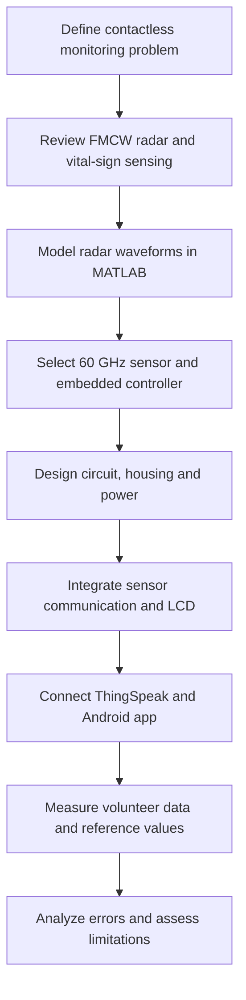
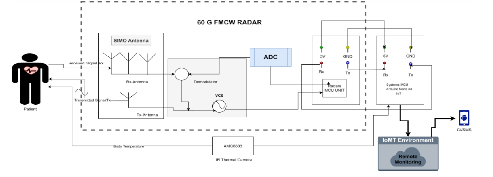
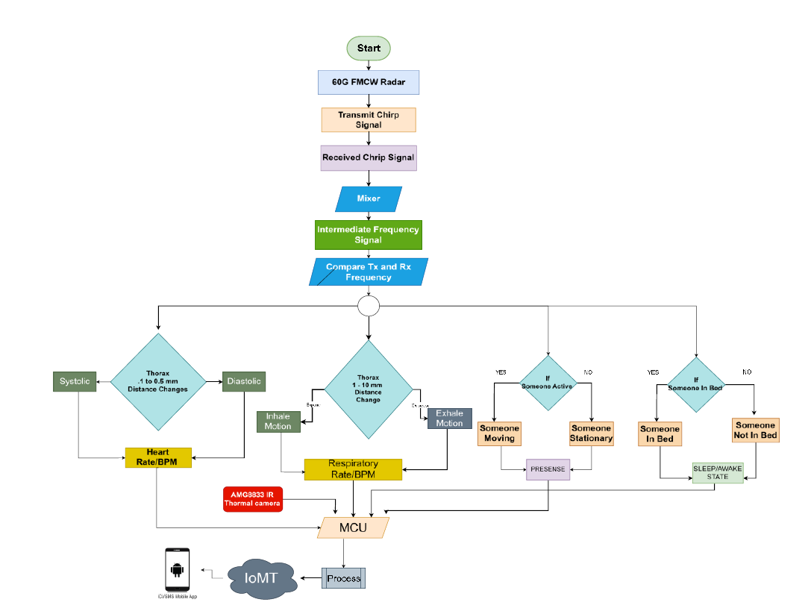

# 02 — Methodology: from radar concept to working prototype

[← Home](../README.md) · [← Objectives](01-problem-and-objectives.md) · [Next: Architecture →](03-system-architecture.md)

I approached CVSMS as a complete system-design project. We first defined what we wanted to measure, then investigated radar behaviour, selected the sensing and control hardware, developed the local/cloud interfaces, and finally evaluated the assembled device.

## Our development process

### Stage 1 — Investigation and component selection

We studied how frequency-modulated continuous-wave radar transmits a chirped waveform and receives a reflection carrying range and movement information. For the prototype, we chose the **MR60BHA1 60 GHz respiration/heartbeat sensor**. Its integrated firmware provides reported vital signs, which made it practical to interface with the **ESP8266 NodeMCU** rather than designing an entire raw radar transceiver and digital processing chain from scratch.

We selected the **AMG8833/AMG88xx** sensor as an additional temperature-related input, an I²C LCD for local display, and ThingSpeak plus MIT App Inventor for the IoMT interface.

### Stage 2 — MATLAB proof of concept

Our MATLAB code studies an idealized radar target and chirp relationship. It sets carrier frequency, bandwidth, chirp duration, target range and velocity, then generates the transmitted and received waveforms. We form an IF representation and examine its FFT and spectrogram.

This stage helped explain the signal-processing principles behind the project. It should not be confused with an implementation of the MR60BHA1's internal heart-rate/respiration estimation pipeline. [See my MATLAB walkthrough](06-matlab-analysis.md).

### Stage 3 — Circuit, enclosure and firmware

We connected the radar to the ESP8266 using UART TX/RX, and the AMG88xx and LCD using a shared I²C bus. We designed a housing with openings for the display and thermal sensor and room for the radar and power components. The documented wiring and 3D enclosure are shown in [Circuit & hardware](04-circuit-and-wiring.md).

### Stage 4 — Local and cloud monitoring

The firmware reads radar reports and the AMG88xx thermistor, displays available measurements, and transmits the values through Wi-Fi to ThingSpeak. Our Android application presents the remote monitoring view through a block-programmed MIT App Inventor interface.

### Stage 5 — Testing and interpretation

Our study covered **18 volunteers and 90 recorded samples**. The capstone describes five readings for each participant, with data collected from younger and older age groups. We compared heart-rate estimates with pulse-oximeter values and examined respiratory-rate comparisons with reference readings, documenting the results in graphs and tables. The capstone also describes measurements under different conditions, including rest and changes in activity. Our public archive contains the reported results and figures, not the underlying participant-level records.

## Original methodology figures

**Figure 3.2.1 — System block diagram**

The system diagram summarizes the two sensing paths—radar and temperature—meeting at the ESP8266 and continuing to the display and cloud monitoring interfaces.

**Figure 3.2.2 — Project flowchart**

The flowchart provides the project-level sequence of measurement and decision steps. It is a design view of our complete system; the embedded source code itself handles the module's already-processed vital-sign reports.

## What the methodology demonstrated

Our main outcome was a connected, working academic prototype, supported by FMCW simulation and comparative testing. The project also exposed the difference between showing that a sensing concept is feasible and claiming clinically verified accuracy. I keep that distinction explicit in the [results chapter](09-results.md).

[Next: System architecture →](03-system-architecture.md)
