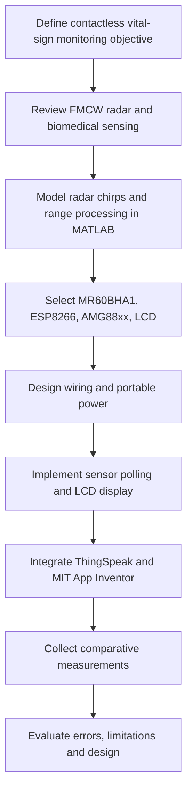

# 02 · Research methodology and implementation workflow

[← Home](../README.md) · [← Problem](01-problem-and-objectives.md) · [Architecture →](03-system-architecture.md)

The following project-oriented presentation is based on the **Methodology and Modeling** and **Project Implementation** chapters of the June 2024 capstone book. It is a technical summary, not a verbatim reproduction.

## Stage 1 — Physical sensing concept
Chest displacement modulates the phase of a reflected radar wave. Breathing typically produces larger and slower periodic motion than cardiac mechanical motion. The chosen **MR60BHA1 sensor module** performs its own internal processing and exposes vital-sign reports over UART.

## Stage 2 — Mathematical proof of concept
We investigated linear FMCW chirps, delayed reflections, intermediate-frequency signals, FFT-based range analysis and spectrograms using MATLAB. This establishes conceptual radar behaviour; **the capstone MATLAB script is not the radar module's proprietary on-device DSP**.

## Stage 3 — Hardware integration
The ESP8266 receives radar reports through serial communication and reads the AMG88xx via I²C. A 20×4 I²C LCD displays values. The prototype also used rechargeable battery/power-conversion components and an enclosure.

## Stage 4 — IoMT data path
The ESP8266 connects to Wi-Fi, posts heart rate, respiratory rate and temperature to ThingSpeak fields, and the Android application presents cloud values remotely. Screenshots of the original app and cloud dashboard are included below; editable project files are not included.

## Stage 5 — Validation and review
The capstone discusses tests with people in different age groups and conditions, including rest and after exercise. Its results should be read alongside the measurement protocol, reference instruments and limitations; the raw participant-level dataset is not part of this repository.

## How to read the project
Follow the architecture, wiring and firmware chapters for the **actual prototype**. Follow the MATLAB chapter for the **separate radar simulation**. Avoid assuming MATLAB outputs are the ESP8266's real-time input.

## Original project figures

These images were supplied from the capstone materials and are presented as project documentation, not independently reproduced measurements.

### System block diagram (capstone Fig. 3.2.1)

### Monitoring workflow (capstone Fig. 3.2.2)

