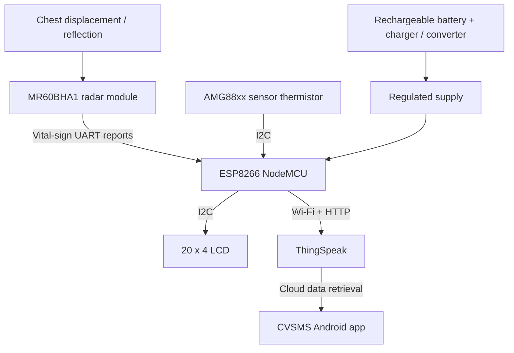

# 03 · System architecture and data flow

[← Home](../README.md) · [← Methodology](02-methodology.md) · [Circuit →](04-circuit-and-wiring.md)

## Responsibilities
| Module | Role | Interface |
|---|---|---|
| MR60BHA1 | Radar sensing and module-level vital-sign reports | UART Tx/Rx |
| ESP8266 NodeMCU | Sensor integration, local presentation and network upload | UART, I²C, Wi-Fi |
| AMG88xx / AMG8833 family | Thermal sensor; appendix firmware reads its **thermistor** | I²C |
| 20×4 LCD | Local readout | I²C |
| ThingSpeak | Store/visualize cloud channel fields | HTTP over Wi-Fi |
| MIT App Inventor application | Android user interface | Cloud data access |

**Book inconsistencies:** The capstone's component list mentions a 16×2 display in one place while its appendix firmware initializes a **20×4** LCD. This repository documents the **20×4 code configuration** and flags the discrepancy rather than asserting a single verified hardware revision.

## Data dictionary
| Cloud field | Intended content | Typical unit |
|---|---|---|
| `field1` | Heart rate | beats/min |
| `field2` | Respiratory rate | breaths/min |
| `field3` | AMG88xx thermistor temperature | °C |

The cloud field mapping is inferred directly from the appendix POST body; ThingSpeak channel IDs and original app blocks have not been recovered.
