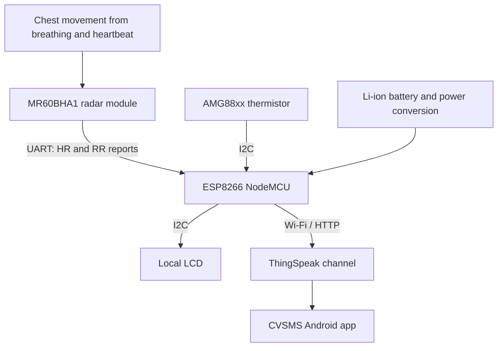

# 03 — System architecture and data flow

[← Home](../README.md) · [← Methodology](02-methodology.md) · [Next: Circuit →](04-circuit-and-wiring.md)

We designed CVSMS around a simple principle: the sensor captures movement-related information, the ESP8266 receives the available measurements, and the interface makes the results accessible without requiring access to the underlying electronics.

## The complete measurement path

## How each subsystem contributes

### Radar module: sensing and reporting

Our radar transmits in the 60 GHz band and senses the subtle chest movement associated with breathing and heartbeat. The MR60BHA1 performs its own internal processing and exposes the processed rate reports over UART. The ESP8266 receives those reports; it is not directly digitizing raw radar I/Q samples.

### ESP8266: the integration point

We selected the NodeMCU because it combines a programmable microcontroller with Wi-Fi. It handles the radar serial interface, the I²C peripherals and the ThingSpeak upload logic. Its role is integration and communication rather than the full internal radar DSP chain.

### Temperature and LCD: additional local information

Our AMG88xx component is capable of thermal sensing, but the recovered firmware specifically calls **`amg.readThermistor()`**. I therefore describe the displayed and transmitted temperature field as the **module thermistor reading**, not a validated measurement of a person's core body temperature. The LCD displays that field alongside incoming heart-rate and respiratory-rate reports.

### ThingSpeak and Android: remote access

We created a ThingSpeak channel with three data fields. Through the Android application developed in MIT App Inventor, we could view the cloud-side monitoring results as part of our prototype demonstration.

| ThingSpeak field | Reported value | Unit |
|---|---|---|
| `field1` | Heart rate from radar report | beats per minute |
| `field2` | Respiratory rate from radar report | breaths per minute |
| `field3` | AMG88xx thermistor | °C |

## Why I separated the code into distinct areas

The radar sensing, embedded communication and MATLAB study serve different purposes. The **MATLAB model** establishes the theory of chirps and IF signals; the **MR60BHA1** produces vital-sign reports; the **ESP8266 firmware** moves those reports through the monitoring system. Keeping those functions separate makes it easier to understand what was implemented in hardware and what was studied through simulation.

## A small but important hardware discrepancy

One component list in our book mentions a **16×2 LCD**, while the Appendix Z program initializes a **20×4 LCD (`0x3F`)**. The recovered firmware uses that documented 20×4 configuration. A replacement unit must be checked for its actual dimensions and I²C address.

[Next: Circuit, wiring and power →](04-circuit-and-wiring.md)
