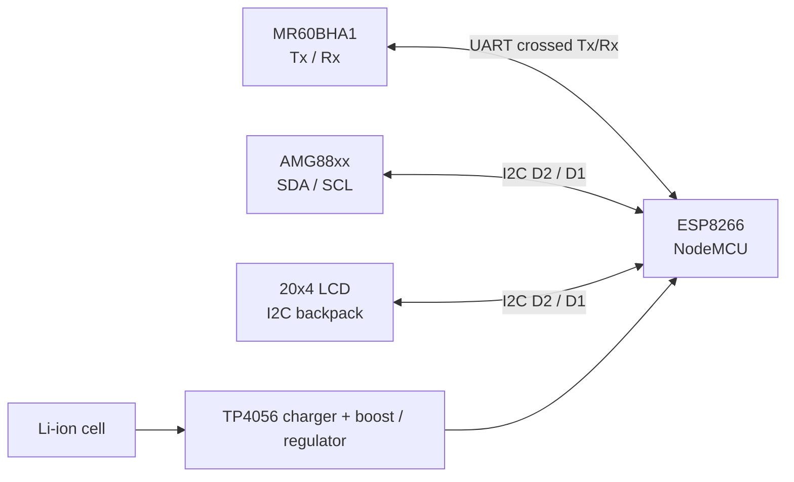

# 04 · Circuit explanation, wiring and power

[← Home](../README.md) · [← Architecture](03-system-architecture.md) · [Radar theory →](05-fmcw-radar-theory.md)

## Circuit connections recorded in the book
The following table transcribes the **logical connections** in the capstone's **Table 4.3.2 (p. 48)**. It is not a verified production wiring schematic.

| ESP8266 NodeMCU | Connected device | Device pin | Explanation |
|---|---|---|---|
| `Vin` | MR60BHA1 radar | `VCC` | Radar module supply; **verify required voltage/current and board regulator** |
| `G` | MR60BHA1 radar | `GND` | Common electrical reference |
| `Rx` | MR60BHA1 radar | `Tx` | Radar reports enter the ESP8266 UART receiver |
| `Tx` | MR60BHA1 radar | `Rx` | ESP8266 transmits to the radar's UART receiver |
| `3.3V` | AMG88xx | `Vin` | Sensor power, only if breakout supports this supply |
| `G` | AMG88xx | `GND` | Common ground |
| `D1` | AMG88xx | `SCL` | I²C clock |
| `D2` | AMG88xx | `SDA` | I²C data |
| `G` | LCD module | `GND` | Common ground |
| `Vin` | LCD module | `VCC` | LCD supply; verify module voltage and I²C pull-up levels |
| `D1` | LCD module | `SCL` | Shared I²C clock |
| `D2` | LCD module | `SDA` | Shared I²C data |

## Logical circuit

### Why the UART lines cross
The transmitting pin of one device connects to the receiving pin of the other. **Important:** The original firmware uses `Serial` both for the radar interface and for debug prints. That can corrupt communication or cause ambiguous wiring on a single-UART ESP8266. The firmware is preserved as a reconstruction, **not a verified safe wiring design**. A revised build should assign an appropriate dedicated UART/serial strategy and confirm the radar's electrical logic levels.

### Why I²C can be shared
The thermal sensor and LCD use the same SDA and SCL buses but have distinct addresses. The appendix initializes the LCD at `0x3F`; some LCD backpacks use `0x27`. Confirm with an I²C scan. The ESP8266's I²C lines are **3.3 V logic**; check LCD pull-up resistors and use level shifting when required.

### Power architecture
The capstone describes a lithium-ion battery, a TP4056-based charger and boost conversion. These parts require correct cell protection, charging current, wiring polarity and output regulation. **Do not connect raw battery or unverified boosted voltage directly to 3.3 V GPIO.** Use the individual module datasheets to verify power compatibility.

### Circuit diagram status
This is a **faithful connection-table-based diagram**, not an extracted photograph or CAD schematic. The original book's figure and enclosure photographs are not bundled here because the underlying PDF image assets have not yet been recovered and verified. Add them later under `assets/original-figures/` with captions and figure provenance.

## Original project figures

These images were supplied from the capstone materials and are presented as project documentation, not independently reproduced measurements.

### Prototype wiring diagram (capstone Fig. 5.2.1.2)

### Annotated hardware assembly (capstone Fig. 4.3.2.2)

### Enclosure CAD view 1 (capstone Fig. 3.3.1)

### Enclosure CAD view 2 (capstone Fig. 3.3.2)

### 60 GHz radar module (capstone Fig. 4.2.1)

### ESP8266 NodeMCU and pin reference (capstone Fig. 4.2.2)

