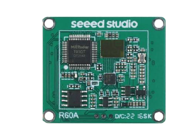
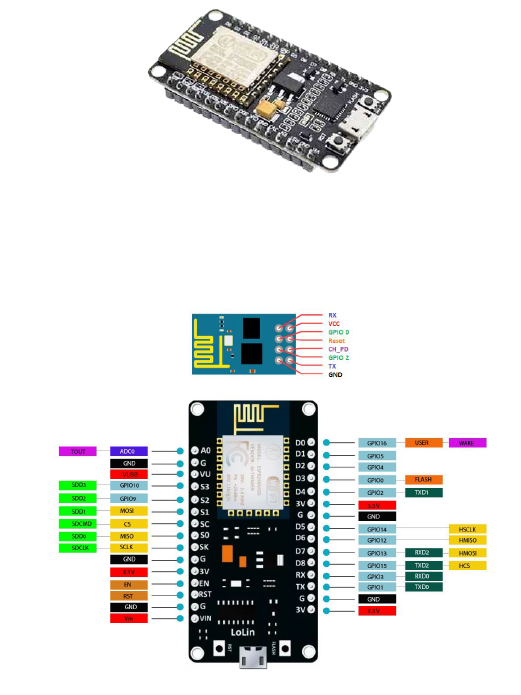
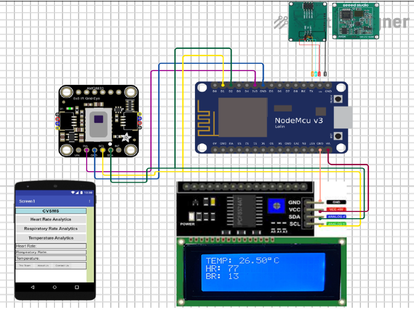
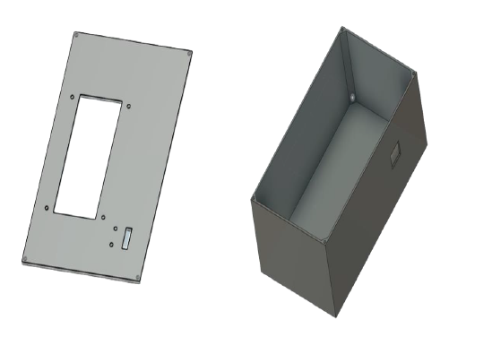
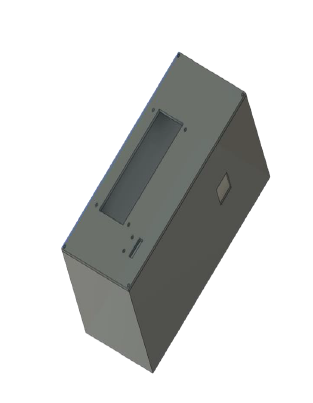
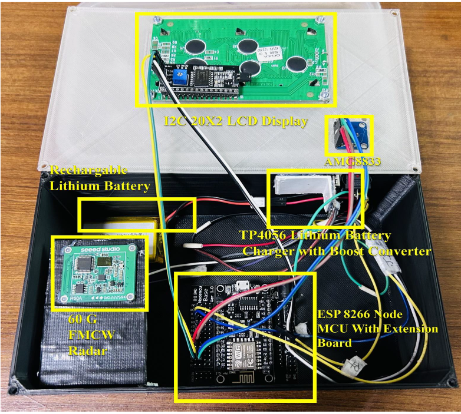

# 04 — Circuit design, components, wiring and enclosure

[← Home](../README.md) · [← Architecture](03-system-architecture.md) · [Next: Radar theory →](05-fmcw-radar-theory.md)

This is the part of our project where the sensing concept became a physical electronic system. We combined the radar, controller, thermal sensor, display and power supply inside a portable enclosure. The wiring table below follows **Table 4.3.2, page 48 of our capstone book**.

## 1. Component overview

| Component | Why we included it |
|---|---|
| **MR60BHA1 60 GHz radar** | Non-contact heart-rate and respiratory-rate reports |
| **ESP8266 NodeMCU** | Main integration controller with UART, I²C and Wi-Fi |
| **AMG8833 / AMG88xx** | Additional thermal-sensor module; firmware reads thermistor |
| **I²C LCD** | Displays current readings without needing the phone |
| **Li-ion battery, charger and converter** | Prototype's portable power subsystem |
| **3D-modeled enclosure** | Holds the hardware, protects connections and positions the display and sensor |

### Radar and MCU

*60 GHz radar module referenced in our build.*

*NodeMCU board and pin-reference illustration.*

## 2. Pin-level connections

| NodeMCU pin | Connected device | Peripheral pin | Purpose |
|---|---|---|---|
| `Vin` | Radar | `VCC` | Radar power (confirm required module supply voltage) |
| `GND` | Radar | `GND` | Common electrical ground |
| `RX` | Radar | `TX` | Receive radar UART reports |
| `TX` | Radar | `RX` | UART transmit path to radar |
| `3.3V` | AMG88xx | `VIN` | Sensor supply, subject to breakout requirements |
| `GND` | AMG88xx | `GND` | Common ground |
| `D1` | AMG88xx | `SCL` | Shared I²C clock |
| `D2` | AMG88xx | `SDA` | Shared I²C data |
| `Vin` | LCD module | `VCC` | LCD power (check backpack rating) |
| `GND` | LCD module | `GND` | Common ground |
| `D1` | LCD module | `SCL` | Shared I²C clock |
| `D2` | LCD module | `SDA` | Shared I²C data |

**UART TX and RX cross:** radar TX goes to NodeMCU RX, and radar RX goes to NodeMCU TX. We connected all modules to a common ground.

**I²C shares two wires:** the temperature module and LCD both use `D2` for SDA and `D1` for SCL. The devices must have separate addresses. The appendix code specifies LCD address `0x3F`; some aftermarket LCD backpacks use `0x27` instead.

> **Electrical check before building:** ESP8266 GPIO operates at 3.3 V. An LCD backpack powered from 5 V may pull its I²C lines above safe logic levels; check pull-ups or use an appropriate level shifter. Verify radar supply and UART logic compatibility rather than assuming the schematic's `Vin` labels guarantee safe operation.

## 3. Original circuit diagram

*Circuit layout included in our project book (Fig. 5.2.1.2). The drawing illustrates the system connections; the pin table above explains the signal paths.*

## 4. Power system

We developed a portable arrangement using a lithium-ion battery, a charging stage based on **TP4056**, and voltage conversion circuitry. The MCU and peripherals require suitable regulated power rails. Battery protection, charging supervision and correct polarity are particularly important when reproducing a prototype.

The book also refers to an external adapter in the implementation discussion. I would verify the exact power routing against the actual assembled unit before producing a manufacturing-grade electrical schematic.

## 5. Enclosure design and hardware assembly

We planned the enclosure in 3D before assembling the hardware. The book describes a housing approximately **7.5 × 4.5 × 3.5 inches**, with openings for the display, thermal sensor and a switch. The design also provides internal space for the radar, battery and controller.

**Our 3D enclosure views — Figs. 3.3.1 and 3.3.2**

**Assembled prototype — Fig. 4.3.2.2**

We designed the device so the radar could be directed toward the chest. Target alignment matters because breathing and heartbeat create only small displacements, and large movement or poor positioning can affect the reported rates.

## 6. Notes from our implementation

- The hardware presented here demonstrates one-person monitoring; it does not separate overlapping vital-sign signals from multiple individuals.
- The original program uses the ESP8266 `Serial` interface for the radar, and the same serial port was also used for debug output in the printed appendix. That needs care during reproduction.
- The display size, I²C address, supply rails, radar wiring and sensor version must be checked against the physical devices rather than inferred only from a screenshot.

[Next: FMCW radar theory →](05-fmcw-radar-theory.md)
