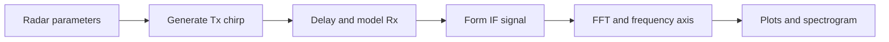

# 06 — MATLAB simulation and FMCW signal analysis

[← Home](../README.md) · [← FMCW theory](05-fmcw-radar-theory.md) · [Next: Firmware →](07-firmware.md)

I used MATLAB in our capstone to explore how an FMCW radar waveform changes between transmission, reflection and the IF stage. Our simulation helped connect the mathematical expressions to the waveforms and frequency plots shown in the project book.

## 1. Parameters from our original script

The following values come from **Appendix Z, pages 73–75** of our capstone book:

| Parameter | Original variable | Value |
|---|---|---:|
| Carrier frequency | `fc` | 60 GHz |
| Maximum simulated range | `maxR` | 200 m |
| Nominal range resolution | `rangeRes` | 1 m |
| Initial target distance | `r0` | 100 m |
| Initial target speed | `v0` | 70 m/s |
| Number of chirps | `Nd` | 128 |
| Samples per chirp | `Nr` | 1,024 |
| Idle interval | `endle_time` | 6.3 µs |

The theoretical bandwidth in this setup is $B=c/(2\Delta R)=150$ MHz. The script sets chirp time to $T_c=5.5(2R_{\max}/c)$ and slope to $B/T_c$.

**Why the 200 m parameter is here:** it belongs to our illustrative FMCW simulation scenario. It is **not** the operating range of the MR60BHA1 respiration sensor in the physical CVSMS prototype.

## 2. Our MATLAB processing sequence



### Transmitted and received signals

The appendix builds the transmit phase using $f_ct+St^2/2$, applies a time-varying round-trip delay to model the target reflection, and generates the received waveform. It then forms an IF expression by comparing the two chirps.

### FFT and visualization

Our script computes an FFT from the IF signal, constructs a frequency axis and converts frequency to range using the chirp slope. It also plots a spectrogram and several time- and frequency-domain figures. The original variable named `doppler` holds a magnitude spectrum here; the script is **not** a full multi-chirp range–Doppler processor.

## 3. MATLAB source code

**[Original capstone Appendix Z script](../matlab/fmcw_original_from_capstone.m)**

This file preserves the algorithm and parameter settings as transcribed from our capstone manuscript, with normalized formatting. It is an archival record of the original proof-of-concept code rather than a newly engineered radar signal-processing pipeline.

**[Supplementary range-FFT demonstration](../matlab/fmcw_corrected_demo.m)**

A separate synthetic, complex-baseband example illustrates range peak estimation without directly sampling the 60 GHz carrier. I keep it separate so that it cannot be mistaken for our original experimental implementation or measured radar data.

## 4. Figures from our capstone analysis

### Transmitted waveform — Figure 5.2.1.1


*The transmitted waveform generated in our MATLAB study.*

### IF signal — Figure 5.2.1.3


*The intermediate-frequency representation obtained by comparing transmitted and delayed received waveforms.*

### IF signal spectrum — Figure 5.2.1.4


*The spectral peak illustrates the relationship between beat frequency and the assumed target position.*

### Spectrogram


*A time–frequency visualization of the simulated signal.*

## 5. Running the scripts

In MATLAB, change the Current Folder to `matlab/`, then run:

```matlab
% Original appendix code, retained for archival study
fmcw_original_from_capstone

% Independent synthetic range FFT demonstration
fmcw_corrected_demo
```

The original uses MATLAB's `spectrogram` functionality, typically supplied by Signal Processing Toolbox. The appendix's high carrier-frequency waveform generation and sampling assumptions are not equivalent to a physically sampled RF acquisition chain; use the supplementary complex-baseband example for a clearer single-target range FFT demonstration.

The original and supplementary MATLAB scripts have not been independently executed in a licensed MATLAB installation for this release, so I do not present their numerical output as externally revalidated results.

[Next: ESP8266 source code →](07-firmware.md)
