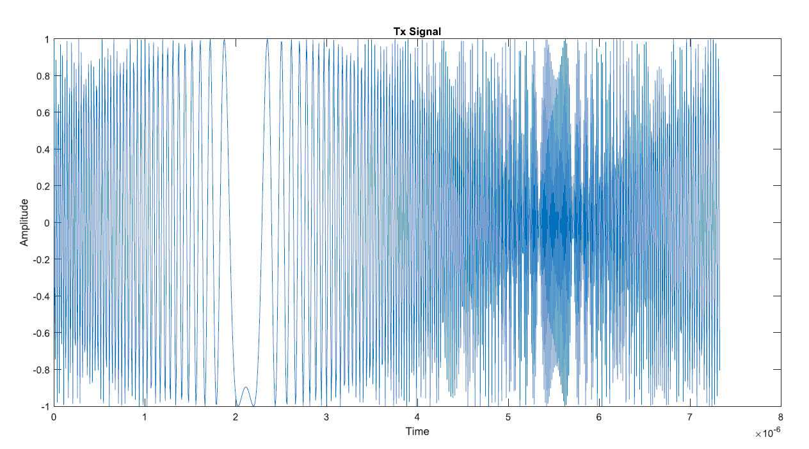
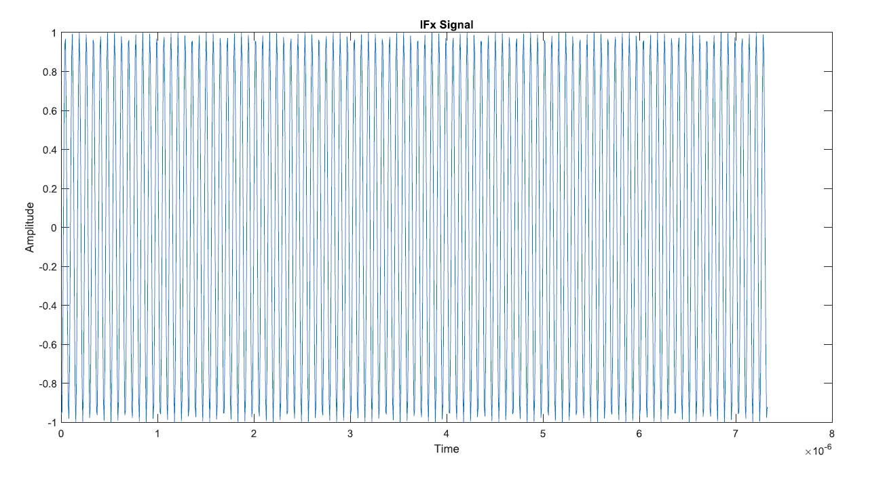
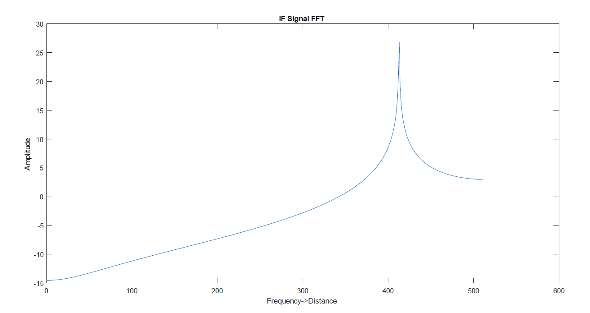
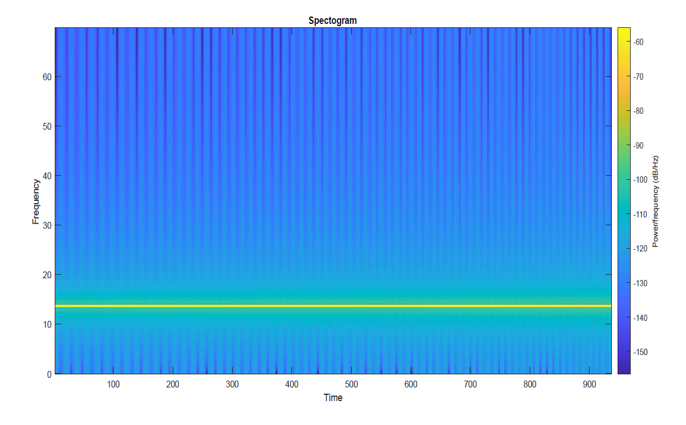

# 06 · MATLAB FMCW simulation and analysis

[← Home](../README.md) · [← Theory](05-fmcw-radar-theory.md) · [Firmware →](07-firmware.md)

## Which code should I open?

| File | Origin | Purpose |
|---|---|---|
| [`fmcw_original_from_capstone.m`](../matlab/fmcw_original_from_capstone.m) | Appendix Z, book pp. 73–75, transcribed and formatted | Preserve original FMCW simulation logic |
| [`fmcw_corrected_demo.m`](../matlab/fmcw_corrected_demo.m) | Later educational implementation | Generate a simpler synthetic stationary-target range FFT |

## Appendix workflow

The original appendix calculates the bandwidth from range resolution, defines a chirp slope, creates transmit and receive waveforms, derives an IF waveform and plots multiple figures. Its plotted outputs are: **Tx**, **Rx**, **Tx frequency versus time**, **chirp frequency versus time**, **IF waveform**, **IF FFT**, and **spectrogram**.

## Parameter example

| Parameter | Appendix value | Meaning |
|---|---:|---|
| Carrier frequency | 60 GHz | RF center frequency |
| Nominal range resolution | 1 m | Target resolution assumption |
| Maximum simulated range | 200 m | MATLAB scenario, **not radar module sensing limit** |
| Number of chirps | 128 | Simulation configuration |
| Samples per chirp | 1,024 | Range sampling configuration |
| Initial target range | 100 m | Synthetic target |
| Initial target speed | 70 m/s | Synthetic moving-target input |

## How to run
1. Open MATLAB.
2. Set the Current Folder to `matlab/`.
3. Run `fmcw_corrected_demo` to produce the **independent synthetic range-FFT example**.
4. Inspect `matlab/figures/synthetic_range_fft.png` if generated.
5. Review `fmcw_original_from_capstone.m` for the archived algorithm. Its execution and scientific correctness have **not** been verified here.

## Important technical limitations
- The appendix mixes very high carrier frequencies with finite sampling, so discrete-time aliasing and numerical interpretation require care.
- The variable named `doppler` in the original is an FFT of a short IF segment; that operation alone is **not** a validated Doppler velocity-processing chain.
- The range-axis and FFT indexing in the archival script should be reviewed before quantitative conclusions.
- The independent demonstration uses a **complex-baseband** beat signal to avoid simulating a directly sampled 60 GHz RF carrier.
- Neither MATLAB script reproduces the module's internal heart-rate extraction or the study's human-subject measurements.

[Continue to hardware firmware →](07-firmware.md)

## Original project figures

These images were supplied from the capstone materials and are presented as project documentation, not independently reproduced measurements.

### MATLAB transmit signal (capstone Fig. 5.2.1.1)

### Intermediate-frequency waveform (capstone Fig. 5.2.1.3)

### FFT of IF signal (capstone Fig. 5.2.1.4)

### MATLAB spectrogram; supplied visualization

