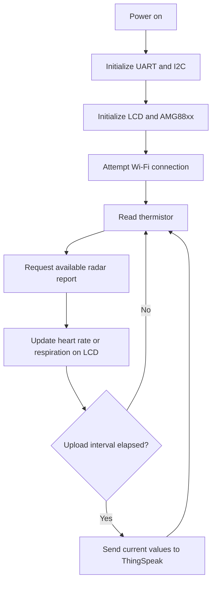

# 07 — ESP8266 firmware and embedded integration

[← Home](../README.md) · [← MATLAB](06-matlab-analysis.md) · [Next: ThingSpeak and Android →](08-iot-android.md)

We used the **ESP8266 NodeMCU** as the link between the sensing hardware, local display and Wi-Fi monitoring system. In our original project, the controller collected the MR60BHA1's vital-sign reports, read the AMG88xx temperature channel, and transmitted the values to ThingSpeak.

**Code:** [CVSMS_ESP8266.ino](../firmware/esp8266/CVSMS_ESP8266/CVSMS_ESP8266.ino)  
**Configuration template:** [secrets.example.h](../firmware/esp8266/CVSMS_ESP8266/secrets.example.h)

## Program sequence



## 1. Initialization

We use `Serial.begin(115200)` for the radar-facing serial interface, initialize I²C and the LCD, and start the AMG88xx module. The device then attempts to establish Wi-Fi connectivity. The printed appendix configured the LCD as **20 columns × 4 rows** at address **`0x3F`**.

## 2. Reading the radar

The radar library exposes `Breath_Heart()` and a `sensor_report` field. Our program interprets the relevant report identifiers for heart rate and breathing rate. A successful report updates the displayed value.

```cpp
radar.Breath_Heart();
if (radar.sensor_report == HEARTRATEVAL) {
    // Update the heart-rate display using radar.heart_rate
} else if (radar.sensor_report == BREATHVAL) {
    // Update the breathing-rate display using radar.breath_rate
}
```

The radar module performs its own vital-sign estimation. The firmware shown here **does not calculate heart rate by applying the MATLAB FFT script to raw radar samples**.

## 3. Reading the thermal sensor

The code calls `amg.readThermistor()` and places that value on the LCD and in the third ThingSpeak field. This is a thermistor reading, and it must not be described as validated body-core temperature.

## 4. Sending measurements to ThingSpeak

We use the following channel layout:

| ThingSpeak field | Value transmitted |
|---|---|
| `field1` | Heart rate (bpm) |
| `field2` | Respiratory rate (breaths/min) |
| `field3` | AMG88xx thermistor (°C) |

In the published reconstruction, the upload interval is set to **20 seconds**. We moved the Wi-Fi password and write key into `secrets.h`, which is excluded from Git tracking. The network code uses plain HTTP, matching the capstone's basic prototype architecture; a production implementation would require secure transport and more robust reconnect/error handling.

## 5. Original code versus reconstructed firmware

The original program appears in **Appendix Z, pages 75–77** of our project book. The `.ino` in this repository is **a reconstruction of that printed program**, rather than a byte-for-byte copy of a saved Arduino IDE sketch. It retains the main acquisition/display/upload sequence but adjusts credential handling, HTTP request formatting and upload timing.

### Important interface consideration

The original sketch shared ESP8266 `Serial` between radar communication and diagnostic prints. That can cause serial traffic to interfere with the radar stream. Hardware reproduction should verify the correct UART arrangement, signal levels and compatible library version before compiling and connecting the system.

## 6. Reproducing the firmware

1. Install Arduino IDE and the ESP8266 board platform.
2. Install compatible versions of the radar `60ghzbreathheart`, Adafruit AMG88xx and LiquidCrystal I²C libraries.
3. Copy `secrets.example.h` to `secrets.h` in the `CVSMS_ESP8266` sketch directory and enter your own credentials.
4. Check the pin mapping and power requirements in the [circuit chapter](04-circuit-and-wiring.md).
5. Open the `.ino` file in Arduino IDE, select your ESP8266 board, and verify compilation and peripheral behavior.

I have not recompiled or bench-tested this reconstruction with the original hardware. I have therefore documented the required checks instead of calling it a fully validated, plug-and-play firmware release.

[Next: Cloud and Android monitoring →](08-iot-android.md)
