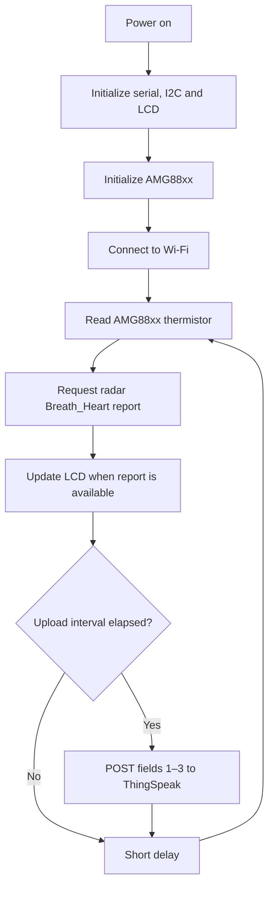

# 07 · ESP8266 / Arduino firmware walkthrough

[← Home](../README.md) · [← MATLAB](06-matlab-analysis.md) · [IoT app →](08-iot-android.md)

**Open code:** [`CVSMS_ESP8266.ino`](../firmware/esp8266/CVSMS_ESP8266/CVSMS_ESP8266.ino) · [Credentials template](../firmware/esp8266/secrets.example.h)

The source is reconstructed from **Appendix Z, pp. 75–77**. Credentials were removed; HTTP formatting and upload interval were revised. It is **not hardware-compiled or hardware-tested** in this environment.

## Firmware sequence

## Core modules
| Include | Role |
|---|---|
| `60ghzbreathheart.h` | MR60BHA1 radar report interface |
| `Adafruit_AMG88xx.h` | Thermistor reading from thermal sensor |
| `LiquidCrystal_I2C.h` | LCD control |
| `ESP8266WiFi.h` | Network connection and TCP client |
| `secrets.h` | Local Wi-Fi credentials and ThingSpeak write key; **not committed** |

### Setup
`setup()` starts the serial interface, initializes I²C and LCD, checks the thermal sensor, and attempts Wi-Fi connection. The example has a bounded Wi-Fi connection wait; failure handling should be improved before unattended deployment.

### Continuous loop
`loop()` reads the AMG88xx thermistor, calls `radar.Breath_Heart()`, examines `sensor_report` and displays heart-rate or breath-rate values when reported. At the configured interval, it constructs an HTTP request containing ThingSpeak `field1`, `field2` and `field3`.

### What is not implemented here
The ESP8266 code **does not** directly sample radar raw I/Q data, perform an FFT to derive vital signs, or run the MATLAB proof-of-concept algorithm. Those measurements are exposed by the radar module's library interface.

## Compile and wiring checklist
1. Install the ESP8266 Arduino board support package.
2. Install **compatible versions** of the radar, AMG88xx and LCD libraries. Their exact original versions are not preserved.
3. Copy `secrets.example.h` to `secrets.h`, insert **new local credentials** and keep the file private.
4. Confirm sensor UART pin assignments, serial-port contention and logic-voltage compatibility. The appendix uses `Serial` for both radar and diagnostics; this requires redesign/verification on real hardware.
5. Confirm I²C address, supply rails, current budget and common ground.
6. Compile, flash and test only after checking the specific board and module datasheets.

## Known limitations
Cloud POST uses an unencrypted HTTP connection as in the historical design. Modern deployments should use TLS where supported, retry logic, Wi-Fi reconnection, robust HTTP response handling and rate limiting. A 200 ms sensor loop is not equivalent to a 200 ms cloud-upload interval; the reconstructed firmware spaces uploads by 20 seconds.
