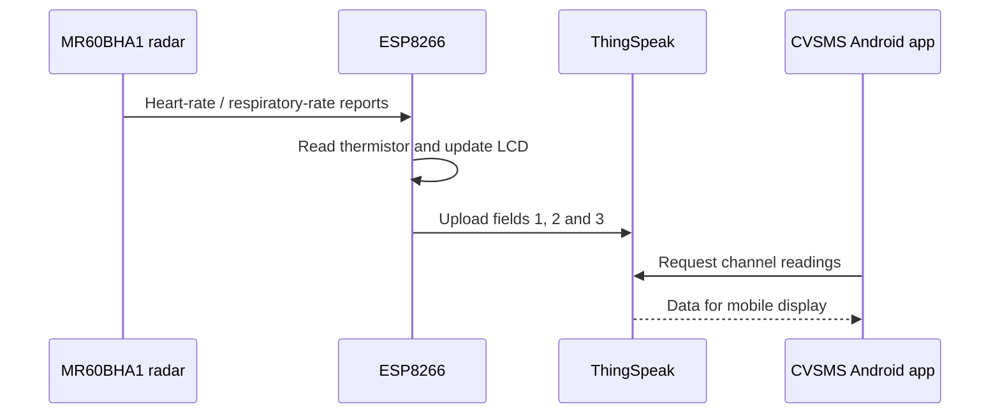

# 08 — ThingSpeak monitoring and our Android application

[← Home](../README.md) · [← Firmware](07-firmware.md) · [Next: Results →](09-results.md)

We wanted the information from the prototype to be accessible beyond the LCD. Our IoMT layer therefore combined **ThingSpeak** for cloud-side storage and visualization with an Android interface we built in **MIT App Inventor**.

## End-to-end cloud workflow

### ThingSpeak channel mapping

| Field | Meaning | Source |
|---|---|---|
| `field1` | Heart rate (bpm) | MR60BHA1 report |
| `field2` | Respiratory rate (breaths/min) | MR60BHA1 report |
| `field3` | Temperature-related reading (°C) | AMG88xx thermistor |

The ESP8266 sends data over Wi-Fi using an HTTP request. ThingSpeak provides the cloud channel used for the graphs and values displayed in our monitoring demonstration.

*The ThingSpeak monitoring screenshots documented in our capstone (Fig. 3.2.4).*

## Building the CVSMS Android interface

We used MIT App Inventor because its visual designer and block programming model made it possible to assemble a dedicated monitoring interface around our ThingSpeak channel. Our app presented the available measurements through screens for the project demonstration.

*The CVSMS Android interface in our capstone (Fig. 3.2.3).*

The screenshot shows the screens and controls we developed for navigating the measurements. It is a record of the original app, not a simulated replacement interface.

## Visual application programming

*The block-based application logic from our project materials.*

Our workflow connected the cloud response to the application's visual components. We treated the Android application as the presentation layer: it **displays** the readings made available through the radar/ESP8266/ThingSpeak system rather than performing the radar's vital-sign analysis itself.

## Scope of the app archive

I have preserved the screenshots available from our project. The original editable MIT App Inventor `.aia` project and compiled `.apk` are **not included**, so a visitor can study the design and blocks but cannot rebuild the exact Android app from source files provided here.

For future development I would use authenticated, read-only cloud access from the app, encrypted network transport, meaningful connection states and error messages, and stricter rules for handling any personal health-related data.

[Next: Results and analysis →](09-results.md)
