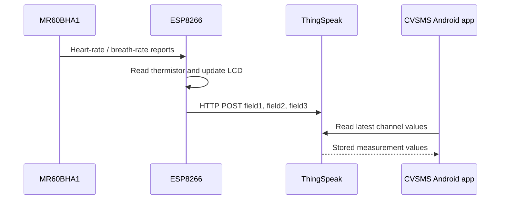
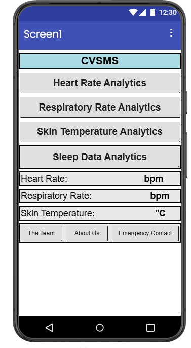
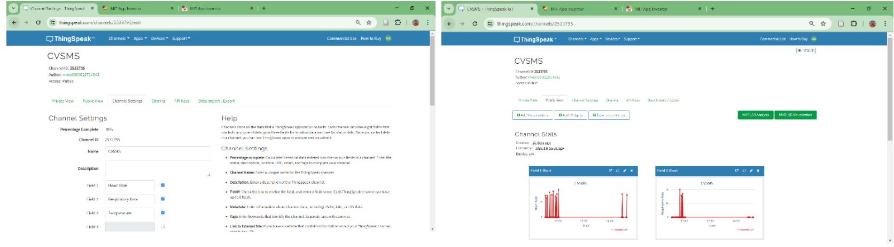
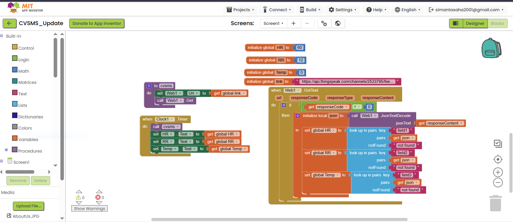

# 08 · ThingSpeak and Android application

[← Home](../README.md) · [← Firmware](07-firmware.md) · [Results →](09-results.md)

## Data journey

## ThingSpeak mapping
- `field1`: radar-reported heart rate, beats/min
- `field2`: radar-reported respiratory rate, breaths/min
- `field3`: AMG88xx **thermistor** reading, degrees Celsius

The book describes remote data access through ThingSpeak and an Android application built in **MIT App Inventor**. MIT App Inventor is a visual, block-based Android development platform; it is **not** an OpenAI product.

## Android screen concept
A useful project page or dashboard would show current HR, RR, temperature, connection status and timestamp, with historical graphs where supported. **This is a suggested presentation**, not an assertion that the unrecovered original app had these exact screen elements.

## Original application artifacts
The `.aia` App Inventor source export, `.apk`, block screenshots and original phone screenshots **are not included**. They must be recovered from the original team archive to show authentic app screens or distribute a runnable application. See [`app/README.md`](../app/README.md).

## Privacy and access
Avoid embedding private ThingSpeak write keys in an Android client or public repository. Distinguish read and write permissions. Do not publicly expose identifiable participant measurements.

## Original project figures

These images were supplied from the capstone materials and are presented as project documentation, not independently reproduced measurements.

### CVSMS Android app interface (capstone Fig. 3.2.3)

### ThingSpeak cloud interface (capstone Fig. 3.2.4)

### MIT App Inventor visual programming blocks

