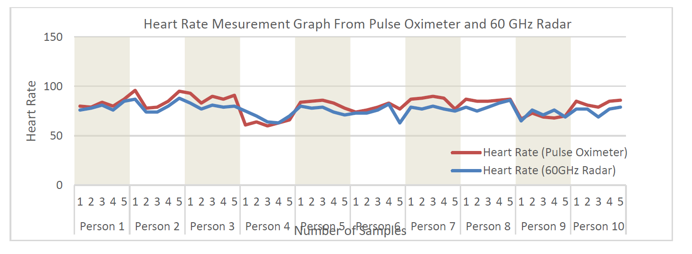
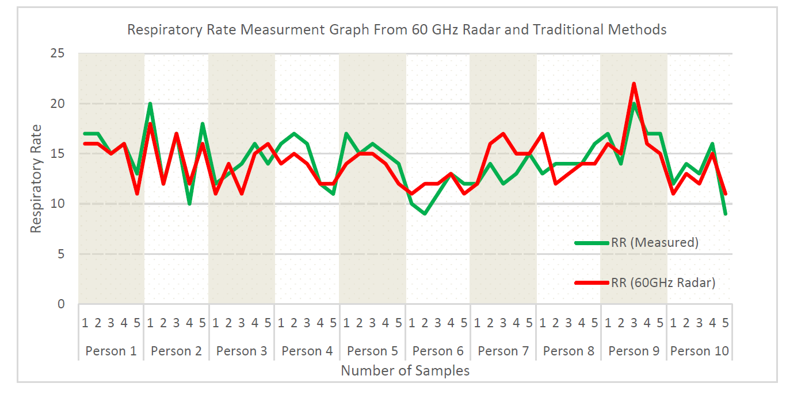
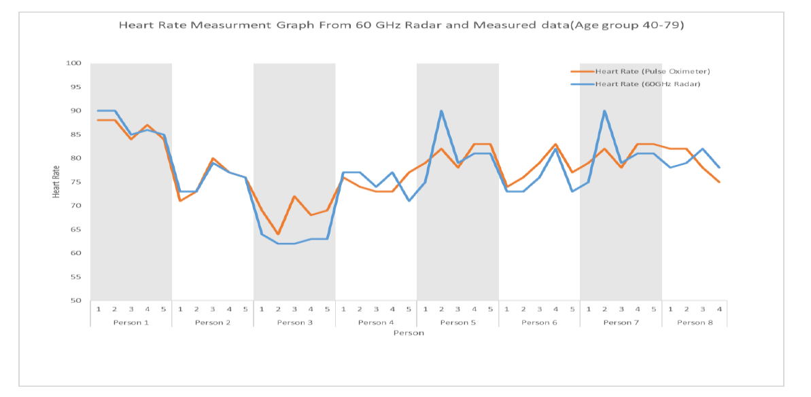
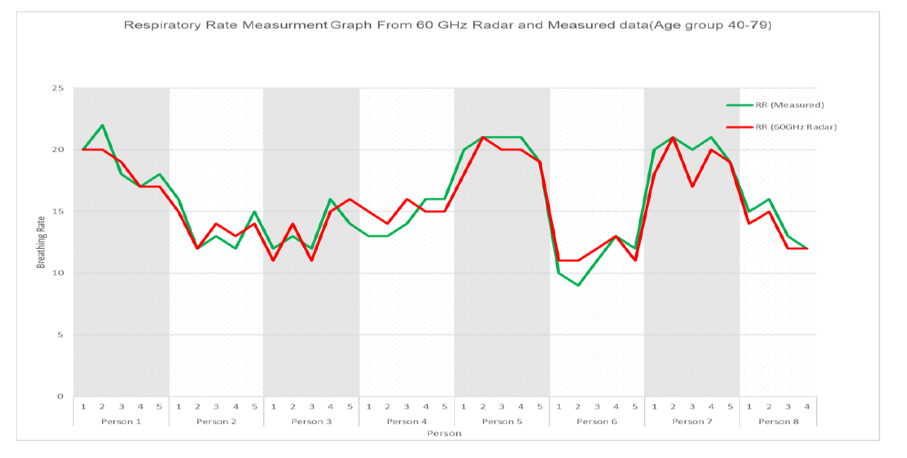

# 09 · Experimental evaluation, findings and limitations

[← Home](../README.md) · [← IoT](08-iot-android.md) · [Reproduce →](10-reproduction.md)

## What the capstone evaluated
The book's **Results Analysis & Critical Design Review** chapter discusses radar-derived heart-rate and respiratory-rate readings, a thermal-sensor readout, comparison with reference instruments, and cloud/application communication.

## Reported summary metrics
The project materials report **18 participants** and **90 samples**. The following previously documented values correspond to **100 − MAPE (%)**:

| Age group | Heart rate | Respiratory rate |
|---|---:|---:|
| 22–25 years | 92.11% | 89.88% |
| 45–79 years | 96.05% | 93.73% |

Mean absolute percentage error (MAPE) is generally

```math
\mathrm{MAPE}(\%)=\frac{100}{N}\sum_{i=1}^{N}\left|\frac{y_i-\hat y_i}{y_i}\right|.
```

A **100 − MAPE** score is a convenient presentation metric, but it is **not** clinical diagnostic accuracy, nor does it quantify sensitivity, specificity, or agreement limits.

## MATLAB results versus prototype results
**MATLAB:** Demonstrates transmitted and received chirps, IF signal, FFT and spectrogram using synthetic radar parameters. **Hardware:** Uses an MR60BHA1 module's internally processed vital-sign reports, ESP8266 readout, LCD and cloud integration. Do not combine their plots into a single experimentally validated signal chain.

## Limitations and future work
- Small reported study and no participant-level raw data in this repository.
- Position, distance, motion and sensor alignment may influence radar reports.
- The thermal-sensor thermistor is not a validated core-temperature measurement.
- Unclear full calibration, confidence intervals and reproducible subject-level protocol.
- No independent medical-device certification or clinical validation.
- Cloud outages and power quality affect availability.

## Future improvements
Document exact reference devices and protocol; publish appropriately anonymized aggregate measurements if authorized; characterize movement artefacts and sensor placement; compare Bland–Altman limits of agreement; redesign serial-port handling and electrical protection; add secure cloud transport.


## Original project figures

These images were supplied from the capstone materials and are presented as project documentation, not independently reproduced measurements.

### Heart-rate comparison: younger group



### Respiratory-rate comparison: younger group



### Heart-rate comparison: older group



### Respiratory-rate comparison: older group



