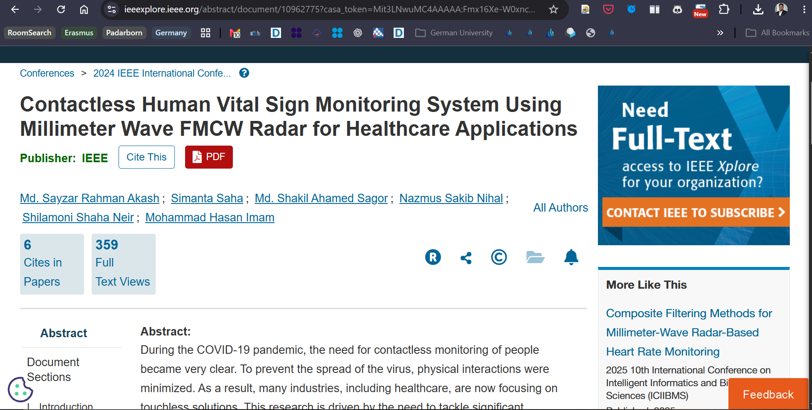

# 11 — Team, recognition and research publication

[← Home](../README.md) · [← Setup](10-reproduction.md) · [Next: Technical archive →](12-source-provenance.md)

## Our capstone team

I served as **team lead** of our CVSMS undergraduate capstone at **American International University–Bangladesh (AIUB)**. Working with my teammates allowed us to develop an end-to-end system that combined sensing hardware, embedded control, software, mobile development and experimental assessment.

| Name | Contribution to the project |
|---|---|
| **Simanta Saha** | **Capstone team lead**; repository maintained under my GitHub profile |
| **Nazmus Sakib Nihal** | Capstone team member |
| **Md. Shakil Ahamed Sagor** | Capstone team member |
| **Shilamoni Shaha Neir** | Capstone team member |

**Project supervisor:** Dr. Mohammad Hasan Imam, Associate Professor, AIUB  
**External supervisor:** Dr. Md. Humayun Kabir, Associate Professor, AIUB

Our capstone book was approved on **6 June 2024**. Every part of the original design and results represents our collaborative work. I have not assigned individual authorship of specific circuit blocks or lines of code where the capstone record does not provide that distinction.

## Recognition at AIUB

### Dean's Award for Best Capstone Project

Our CVSMS work was recognized with the **Dean's Award for Best Capstone Project** at AIUB.

### Vice Chancellor's Award

I also received the **Vice Chancellor's Award** at AIUB's **23rd Convocation**.

## IEEE BECITHCON 2024 publication

Our related research was presented at **IEEE BECITHCON 2024** under the title:

**“Contactless Human Vital Sign Monitoring System Using Millimeter Wave FMCW Radar for Healthcare Applications.”**

**Authors:** Md. Sayzar Rahman Akash, Simanta Saha, Md. Shakil Ahamed Sagor, Nazmus Sakib Nihal, Shilamoni Shaha Neir, and Mohammad Hasan Imam.  
**Proceedings:** IEEE BECITHCON 2024, pp. 137–142.  
**DOI:** [10.1109/BECITHCON64160.2024.10962775](https://doi.org/10.1109/BECITHCON64160.2024.10962775)

*Screenshot of an online listing for our publication. This image is not the formatted first page of the conference paper.*

The **research paper author list** is not identical to the **four-student capstone team roster**. I have included both lists to credit everyone accurately.

## What this project meant for me

CVSMS was a major part of my development as an electrical and electronic engineering student. Leading the capstone gave me hands-on experience with system integration and the discipline of connecting simulation, hardware and evaluation into one coherent research outcome. It also strengthened my interest in radar sensing, signal processing and embedded engineering.

[Next: Technical archive and attribution →](12-source-provenance.md)
