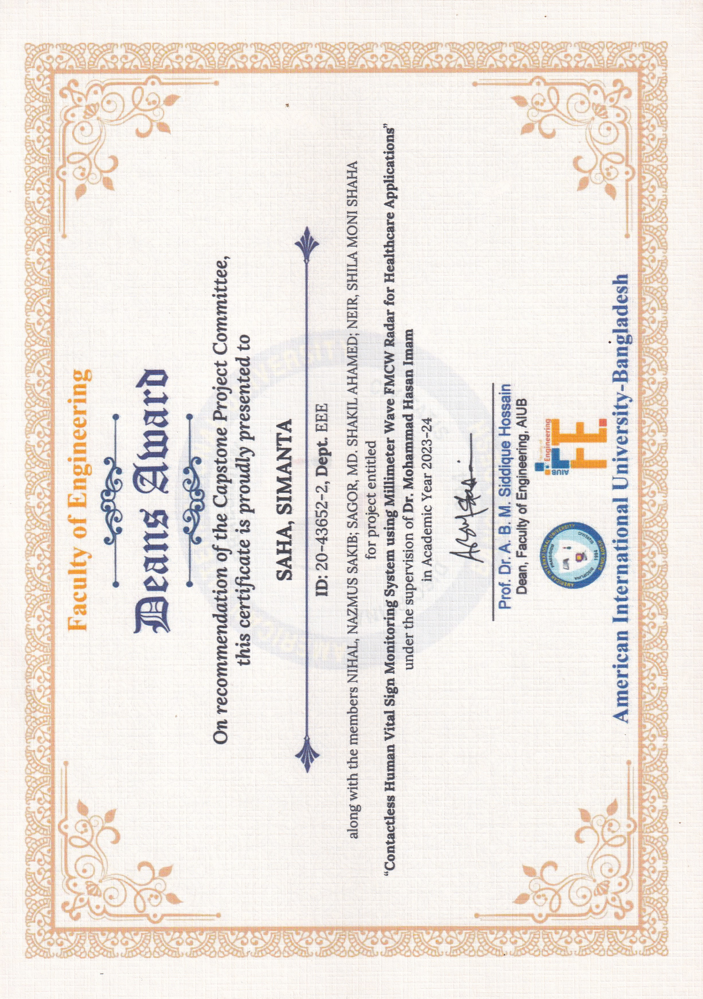
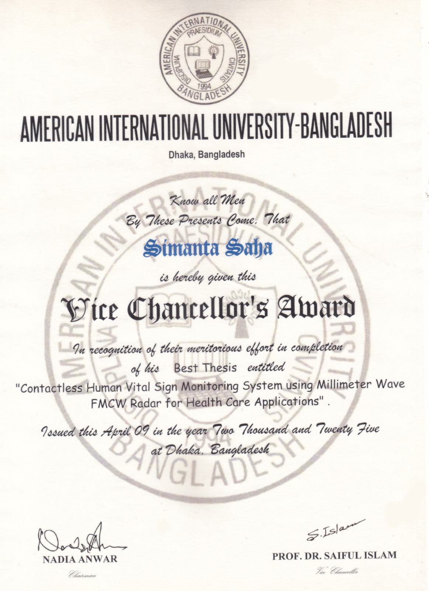

# 11 · Team, academic recognition and publication

[← Home](../README.md) · [← Reproduction](10-reproduction.md) · [Provenance →](12-source-provenance.md)

## Capstone team — AIUB, June 2024
| Contributor | Credit |
|---|---|
| **Simanta Saha** | **Capstone team lead; repository maintainer** |
| Nazmus Sakib Nihal | Capstone team member |
| Md. Shakil Ahamed Sagor | Capstone team member |
| Shilamoni Shaha Neir | Capstone team member |

**Supervisor:** Dr. Mohammad Hasan Imam, Associate Professor, AIUB.  
**External supervisor:** Dr. Md. Humayun Kabir, Associate Professor, AIUB.

The source code, prototype and academic work were collaborative. Individual ownership of a particular circuit, source file, figure or experiment should not be inferred from the repository maintainer role.

## Recognition
- Dean's Award for Best Capstone Project, AIUB
- Vice Chancellor's Award, AIUB 23rd Convocation
- Research grant mentioned by the project lead; **awarding body, grant number and funding details not yet verified**

## IEEE conference paper
Md. Sayzar Rahman Akash, Simanta Saha, Md. Shakil Ahamed Sagor, Nazmus Sakib Nihal, Shilamoni Shaha Neir, and Mohammad Hasan Imam. **Contactless Human Vital Sign Monitoring System Using Millimeter Wave FMCW Radar for Healthcare Applications.** *IEEE BECITHCON 2024*, pp. 137–142. [DOI: 10.1109/BECITHCON64160.2024.10962775](https://doi.org/10.1109/BECITHCON64160.2024.10962775).

The IEEE author list is not identical to the four-student capstone team roster; both are preserved accurately.

## Original project figures

These images were supplied from the capstone materials and are presented as project documentation, not independently reproduced measurements.

### IEEE BECITHCON publication page

### Dean’s Award certificate

### Vice Chancellor’s Award certificate

